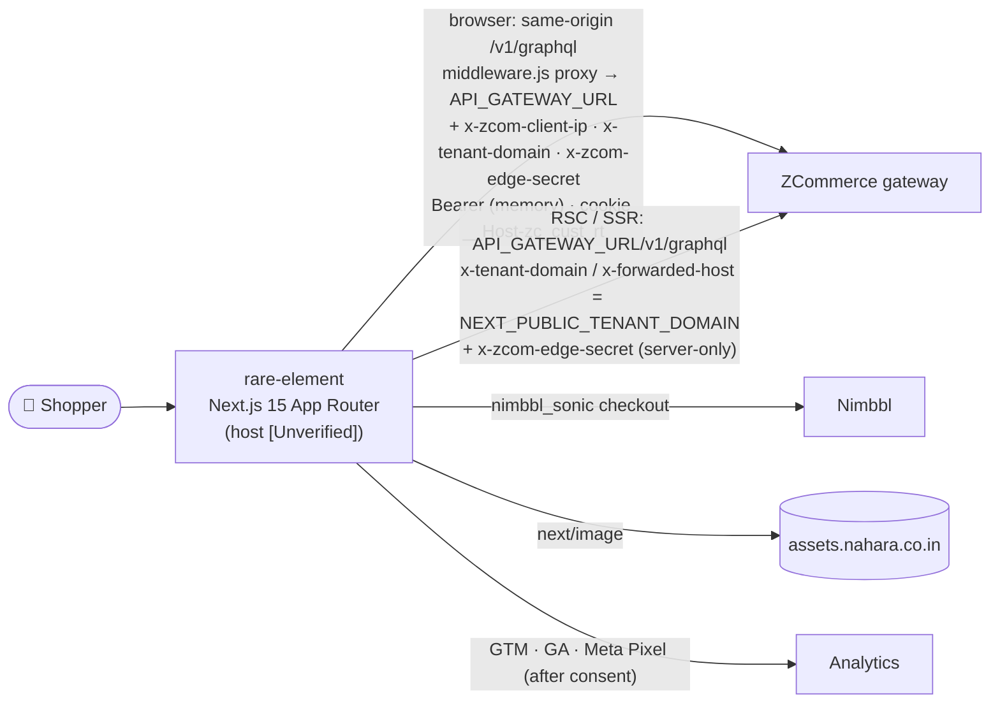
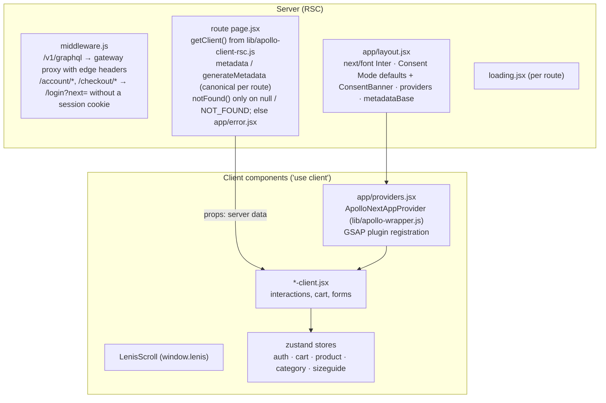
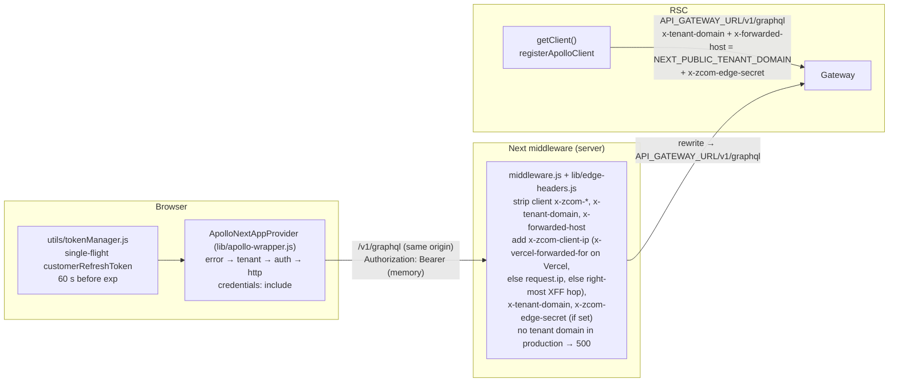
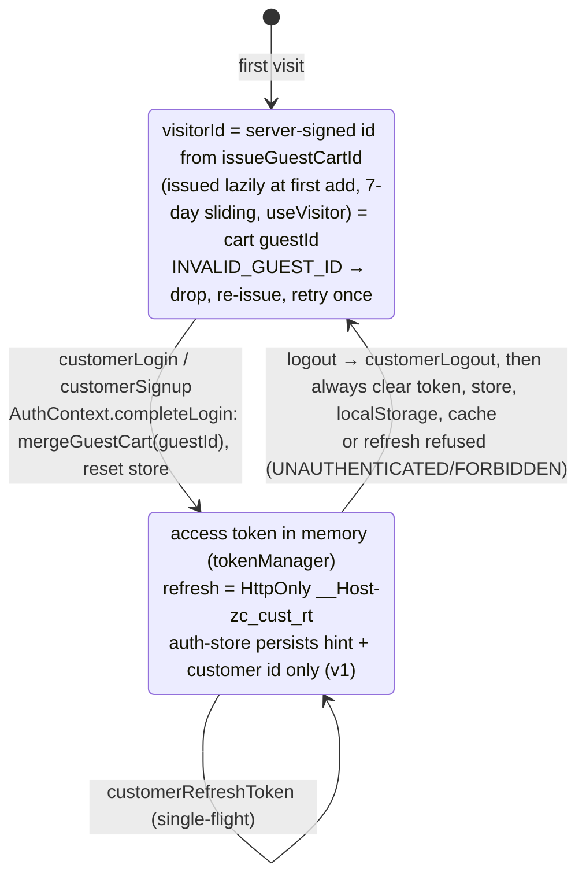
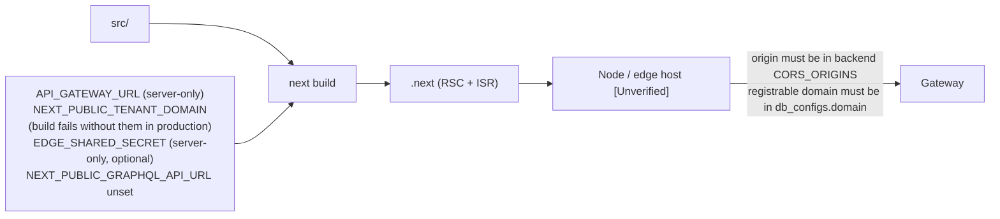

# rare-element: Solution Architecture (Rare Element / Nahara storefront)

| | |
|---|---|
| **Status** | Living document. Verified against code on **2026-10-14** (after PRD-002 WS-F1 and round 2, R2-W6) |
| **Parent** | Workspace `../../ARCHITECTURE.md` · `../../storefronts/CLAUDE.md` |
| **API contract** | `../../zcom-backend/docs/architecture/storefront-api-contract.md` |
| **Role** | **Reference pattern** for new storefronts (App Router, RSC, ISR, host-based tenant, same-origin API through a middleware proxy, cookie session). Contract: 34/34 operations valid |

---

## 1. Purpose and context

This is the brand storefront where shoppers browse Rare Element / Nahara products, manage an account and wishlist, and check out with Nimbbl.



## 2. Rendering architecture



### Route map and caching

| Route | Server data | Caching |
|---|---|---|
| `/` | Home collections | `revalidate = 300` (ISR) |
| `/products` | Product list | ISR 300 |
| `/products/[slug]` | Product detail, `generateMetadata` (seo, Open Graph, Twitter), Product JSON-LD (offers; `availability` from `Product.availability` when the store's stock signal is on, PRD-020 FR-14), latest 10 approved reviews (`getReviews`, PRD-014 FR-2.8); an id permanently redirects to the slug | ISR 300 |
| `/search?q=` | Product search, `filters.search` on `getClientSideProducts` (client, PRD-014 FR-2.8) | Dynamic, `noindex, follow` |
| `/sitemap.xml`, `/robots.txt` | `app/sitemap.js` (static pages, categories, ≤ 1000 published products) and `app/robots.js` (sitemap URL from `NEXT_PUBLIC_SITE_URL`), PRD-014 FR-2.8 | Sitemap revalidated hourly; robots static |
| `/[...categories]` | Category listing, `generateMetadata` | ISR 300 |
| `/account`, `/account/settings`, `/account/wishlist`, `/account/order/[id]` (`/account/offers` removed, PRD-014 UX-06; the order page shows `displayStatus`, tracking, Cancel and returns, PRD-015 FR-20) | Per user (client side) | Dynamic, never cached |
| `/checkout/[id]` | The customer's own cart (the id in the URL is cosmetic) | Dynamic, login required |
| `/checkout/thank-you` | Polls `myOrder` (client) | Static shell |
| `/checkout/payment-failed` | — | Static |
| `/unsubscribe` | Reads `?email=&token=` once, strips them from the URL, calls `unsubscribeNewsletter` (client, VCON-1) | Static shell, `noindex,nofollow` |
| `/forgot-password`, `/reset-password` | Password reset (PRD-003 FR-0.5): `customerRequestPasswordReset` (uniform answer), then the emailed link `/reset-password?token=…` is read once, stripped from the URL and sent with `customerResetPassword` (client) | Static shells, `noindex, nofollow` |
| `/login`, `/about`, `/contact`, legal pages | — | Static |

## 3. Data access



- **Edge headers (PRD-002 R2-C1, ROPS-1):** the gateway trusts `x-tenant-domain` and `x-zcom-client-ip` only with a valid `x-zcom-edge-secret`, so per-shopper rate limits key on the real IP instead of the host's. `EDGE_SHARED_SECRET` is server-only: `lib/edge-headers.js` is imported by `middleware.js` and the RSC client, and by `apollo-wrapper.js` only under an inline `typeof window === "undefined"` check (the SSR pass of client components calls the gateway directly), so the browser bundle never contains it. The old `next.config.mjs` rewrite was removed because a config rewrite can't set request headers.
- **Client IP and tenant (PRD-002 round 3, VSEC-3/VSEC-4):** `getClientIp` takes `x-vercel-forwarded-for` only when `VERCEL` is set (Vercel overwrites it), then `request.ip`, then the right-most `x-forwarded-for` hop; the first hop and `x-real-ip` are client-controlled and never used. The proxy strips client `x-tenant-domain` and `x-forwarded-host`, and in production fails closed (500) without `NEXT_PUBLIC_TENANT_DOMAIN`; dev falls back to `localhost:3000`. The RSC client and the SSR pass of client components send no `x-zcom-client-ip` (a client component can't read `headers()`, and `headers()` in the root layout would end ISR), so the gateway sees the host's IP for those calls; this is an open design decision. The backend's 30/min per-IP login bucket across tenants (`AUTH_IP_RATE_LIMIT_PER_MIN`) makes setting `EDGE_SHARED_SECRET` in the same deploy as backend round 3 necessary.
- **Error link:** `TOKEN_EXPIRED` → refresh once, retry; `INVALID_AUTH_TOKEN` / `TENANT_MISMATCH` / `INVALID_DB_TOKEN` → `SESSION_ENDED`; `TENANT_NOT_FOUND` → one "store unavailable" toast (R2-C5). A refresh ends the session only on auth or tenant codes, never on network or rate-limit errors (RBUG-19).
- **Auth link:** if the shopper is logged in (persisted hint) but has no valid token, it waits for the refresh first (page reloads). `context.skipAuth` sends a request anonymously.
- **Errors** are mapped by `utils/errors.js` from `extensions.reason` / `code`.

**Operations in use (all ✅, 33):** customer auth (`customerLogin`, `customerSignup`, `customerRefreshToken`, `customerLogout`, `getMyProfile`, `updateMyProfile`); catalog (`getClientSideProducts`, `getClientSideProductById`, `getClientSideCategories`, `getClientSideCategory`, `getFilterOptions`); cart (`issueGuestCartId`, `mergeGuestCart`, line mutations) and promotions; checkout (`createCheckoutSessionFromCart`, `getCheckoutSession`, `completeCheckout`, `createPaymentSession`, `verifyPayment`); `myOrders` / `myOrder`; addresses (full CRUD); `getWishlist` / `toggleWishlist`; `submitContactForm`; `requestBackInStock`; PRD-003 FR-0.5 (2026-10-15) adds `customerRequestPasswordReset` and `customerResetPassword` (36 in total with `unsubscribeNewsletter`). PRD-014 FR-2.8 (2026-10-25) adds `subscribeNewsletter` (footer), `getReviews` (PDP) and a sitemap read of `getClientSideProducts`; FE-22 adds `getClientSideProductsByIds` (wishlist). PRD-020 FR-12 (2026-10-26) adds `getVariantAvailability` (the fresh stock read on the PDP and the cart drawer) and selects `availability` on products and variants; PRD-015 FR-20 adds `cancelMyOrder`, `createReturnRequest` and `cancelMyReturnRequest` on the order page. 44 documents, validated with `npm run validate:ops` against the composed supergraph.

## 4. Session and guest identity



The visitor id is cleared after a successful `mergeGuestCart` (one idempotent, server-re-priced call, R2-C3), or when the server rejects it; on any other failure it is kept and the shopper is warned. Unsigned UUIDs from before R2-C2 are dropped on read, so old guest bags are lost once at deploy. The profile isn't persisted (RSEC-11); after a reload it's fetched again with `getMyProfile`. The legacy JS `refresh_token` cookie is left for the backend to read and expire during `LEGACY_REFRESH_COOKIE_UNTIL`; the old access token is purged from localStorage.

## 5. Checkout flow

```mermaid
sequenceDiagram
    autonumber
    actor S as Shopper (logged in)
    participant C as checkout-client.jsx
    participant GW as Gateway
    participant NB as Nimbbl
    participant TY as thank-you

    S->>C: fill the form (zod CheckoutSchema)
    C->>GW: createCheckoutSessionFromCart (inline OrderAddressInput)
    loop every 1 s, up to 30 s
        C->>GW: getCheckoutSession
    end
    Note over C: RESERVED → continue · FAILED / EXPIRED → stop with a reason
    C->>GW: completeCheckout → orderId + pricing.total (bag locked from here)
    Note over C: pricing.total = 0 → the order is already PAID (PRD-014 COM-08):<br/>no payment session, straight to thank-you
    Note over C: orderId + cart fingerprint + details fingerprint (email, shipping, billing) saved in sessionStorage (utils/pending-order.js); a retry or reload pays this order while both match
    C->>GW: createPaymentSession({orderId}) → token
    C->>NB: Checkout({token}).open() ("Pay Now" disabled until the callback)
    NB-->>C: callback (processed once)
    C->>GW: verifyPayment(payload)
    C->>TY: success / PENDING / ALREADY_PAID → thank-you; else payment-failed (VERIFY_FAILED, NO_PAYMENT_SESSION, FAILED)
    loop every 3 s, up to 60 s
        TY->>GW: myOrder(orderId)
    end
    Note over TY: PAID → GA4 + Pixel purchase (once per order id); polling → "Processing"; ends unpaid → "Payment not confirmed yet" (RBUG-20)
```

The client **never sends prices**: `addItemToCart` takes `{productId, variantId, qty}` plus `guestId`, and the payable total comes from the session pricing. Closing the Nimbbl window re-enables "Pay Now" for the same order. The pending order is forgotten when payment succeeds or the cart lines or coupon change; a changed email or address creates a new order (VBUG-4), and a legacy entry without the details fingerprint is never reused; the backend separately reuses an unchanged cart's active checkout session and cancels it when the cart changed (R2-C8). Reservation reasons `CHECKOUT_EXPIRED` and `RESERVATION_RELEASED` map to "reservation expired" (R2-C7); `CHECKOUT_REPLACED`, `PAYMENT_NOT_CONFIGURED`, `MISSING_PROVIDER_ORDER` and `INVALID_EMAIL` have their own messages (VCON-2). PRD-014 Wave 1: a ₹0 order skips the payment steps; `SHIPPING_UNAVAILABLE` (no shipping zone for the address) shows "We can't ship to this address yet" and focuses the address; a `VARIANT_REQUIRED` cart remove refetches the bag.

## 6. Presentation layer

| Concern | Implementation |
|---|---|
| Styling | Plain CSS: `styles/allCssImport.css` `@import`s every sheet, and `globals.css` holds hand-written utility classes. No Tailwind or CSS-in-JS |
| Fonts | `next/font` Inter + `styles/fontSetting.css` |
| Motion | GSAP 3.13 (ScrollTrigger, CustomEase) registered once in `providers.jsx`, scoped cleanup (`gsap.context`); `lenis` smooth scroll; lottie via `LazyLottie` (visible only, JSON from `/public`); three/R3F via `dynamic(..., {ssr:false})` |
| Icons | `@remixicon/react` |
| Images | `next/image` with `sizes`; `remotePatterns` allows only `assets.nahara.co.in`; avif/webp; 1-year cache TTL |
| SEO | `metadataBase` from `NEXT_PUBLIC_SITE_URL`; per-route canonicals; `generateMetadata` on categories and products; JSON-LD schema components serialised with `utils/json-ld.js` |
| CMS HTML | `utils/sanitize-html.js` (allowlist over `html-react-parser`'s `htmlToDOM`) |
| Security headers | CSP (GTM/GA, Meta, `*.nimbbl.tech` + Nimbbl helper hosts, assets, `frame-ancestors 'none'`; report-only with `CSP_REPORT_ONLY=true`), X-Frame-Options DENY, nosniff, strict-origin referrer, Permissions-Policy, HSTS in production. `script-src 'unsafe-inline'` is kept: a nonce would force dynamic rendering (no ISR) and GTM custom-HTML tags need it (SF-9 partial) |
| Analytics | Consent first (PRD-014 FR-1.9, D10): `layout.jsx` runs only the Google Consent Mode v2 defaults ("denied"); `components/common/ConsentBanner.jsx` + `utils/consent.js` load GTM and GA after "analytics" consent and the Meta Pixel (first PageView) after "marketing" consent, choice in localStorage `zc_consent`, reopened from the footer "Cookie preferences"; no hard-coded tag ids. Meta Pixel helpers `lib/fpixel.js` (`FacebookPixel.jsx` tracks client navigations only), `utils/analytics.js` (GA4 e-commerce events), `utils/analytics-events.js` (PRD-013 event layer: `select_item`, `select_variant`, `cta_click`, `gallery_interaction`, `size_guide_open`, `notify_me`, `coupon_apply`/`coupon_failed`, `add_shipping_info`, `add_payment_info`, `checkout_error`; `item_id` = variant id), `utils/ga-attribution.js` (PRD-012 order attribution); IDs from env |

## 7. Deployment



## 8. Gaps

| Gap | Impact | Path |
|---|---|---|
| No badge name or password change | No merchant ribbons (stock badges come from PRD-020) | Backend T1 PRDs (contract doc §2) |
| Stock signal is off by default per store (PRD-020 D8) | `null` renders as before; the owner enables it per store after UAT | Owner, UAT on and off |
| Strict tenant mode (`EDGE_SHARED_SECRET`) | Code ready (middleware proxy, RSC and SSR clients send the secret); until the owner sets it, the gateway runs in legacy mode and the backend's per-IP login bucket sees every shopper as this host's IP | Owner sets it here, on EB and on the CloudFront origin header at the same moment, in the same deploy as backend round 3; confirm the host's client IP source |
| SSR calls send no `x-zcom-client-ip` | RSC and client-component SSR calls are rate-limited on the host's IP | Design decision (server-side customer-data path) |
| Every browser API call runs through the Edge middleware (VPERF-4) | Latency and cost per call | Accepted (R3-D7) |
| CSP keeps `script-src 'unsafe-inline'` | XSS defence relies on the sanitiser and JSON-LD escaping | Accepted (ISR, GTM); report-only rollout first |
| Shared logic duplicated with deveshe-dreams | Fixes must be made twice | ADR for a shared package |
| Not browser-tested; Nimbbl callback shape unverified | Unknown runtime issues | Sandbox run after deploy |
| ESLint not installed | Hygiene | T2 |

## PRD-020 stock signal and PRD-015 post-purchase (2026-10-26, not browser-tested)

- **Stock (FR-12, FR-14):** `utils/stock-signal.js` (twin of deveshe `utils/stock-signal.util.js`) maps the nullable `availability` / `availableQuantity` to states; `null` is today's behaviour everywhere. The PDP reads the ISR value, then `hooks/useVariantAvailability.jsx` (`getVariantAvailability`, ≤ 50 ids, never cached server-side) on mount and on a variant change; a failed read keeps the ISR value. Sold-out options are struck through (`aria-label="<value>, sold out"`, still selectable); a sold-out selection shows "Sold out" + "Notify me" (an email field for guests, no login); `LOW_STOCK` shows "Only N left" (opt-in count) or "Low stock". Listing cards show "Sold out" / "Low stock" ribbons from `Product.availability`; the store's `SHOW | SORT_LAST | HIDE` is applied by the server. The cart drawer re-reads on open: a sold-out line shows "Sold out" (Remove stays) and checkout is held with "Remove sold-out items to continue". JSON-LD `offers.availability` comes from the rollup (`utils/product-offers.js`). `select_variant.in_stock` uses the signal when non-null.
- **Post-purchase (FR-20):** `/account/order/[id]` shows the server's `displayStatus`, a tracking block (`shipment { courier awb trackingUrl tracking }`; https links only; the latest five scans), Cancel when `canCancel` (inline confirmation, `cancelMyOrder`), "Request a return" while `returnableItems` is non-empty (per-line steppers capped at `returnableQty`, reason, condition, return-by date, link to `/shipping-returns`; `createReturnRequest` with line ids) and the order's `returnRequests` with "Withdraw" on a REQUESTED one (`cancelMyReturnRequest`). Helpers in `utils/order-detail.js`; every refusal reason is mapped in `utils/errors.js` (also PRD-016 `STORE_ORDERS_PAUSED`).
- Tests: `test/stock-signal.test.mjs`, `test/order-detail.test.mjs`.
