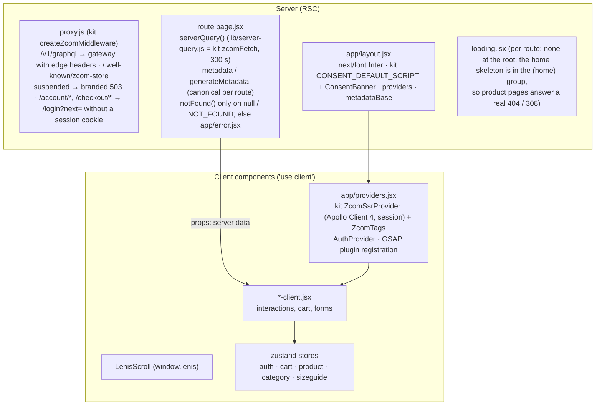
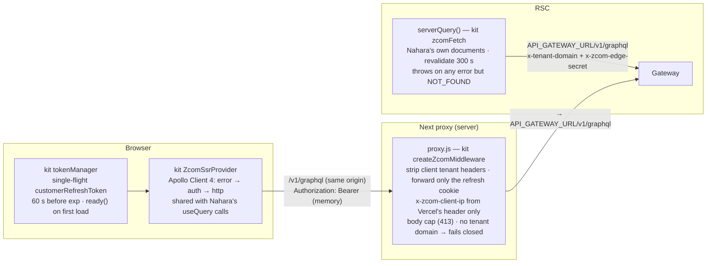
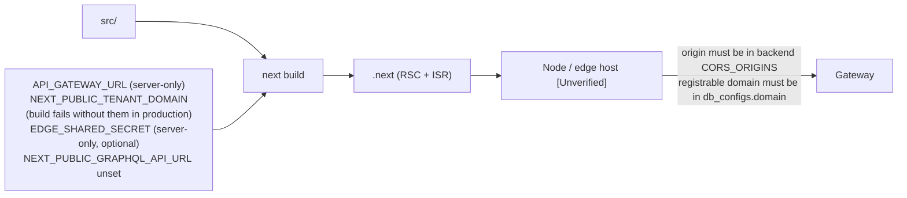

# rare-element: Solution Architecture (Rare Element / Nahara storefront)

| | |
|---|---|
| **Status** | Living document. Verified against code on **2026-11-10** (on `@zcom/storefront-kit` 1.x, kit PRD-002 step 3; earlier: PRD-002 WS-F1 and round 2) |
| **Parent** | Workspace `../../ARCHITECTURE.md` · `../../storefronts/CLAUDE.md` |
| **API contract** | `../../zcom-backend/docs/architecture/storefront-api-contract.md` |
| **Role** | App Router storefront on the kit (RSC, ISR, host-based tenant, same-origin API through the kit's proxy, cookie session). New storefronts start from the kit's `/integrate-zcom` skill. Contract: 61/61 operations valid |

---

## 1. Purpose and context

This is the brand storefront where shoppers browse Rare Element / Nahara products, manage an account and wishlist, and check out with the store's payment app (Razorpay, Cashfree or PayU).


## 2. Rendering architecture



### Route map and caching

| Route | Server data | Caching |
|---|---|---|
| `/` | Home collections | `revalidate = 300` (ISR) |
| `/products` | Product list | ISR 300 |
| `/products/[slug]` | Product detail, `generateMetadata` (seo, Open Graph, Twitter), Product JSON-LD (offers; `availability` from `Product.availability` when the store's stock signal is on, PRD-020 FR-14), latest 10 approved reviews (`getReviews`, PRD-014 FR-2.8); an id permanently redirects to the slug | ISR 300 |
| `/search?q=` | Product search, `filters.search` on `getClientSideProducts` (client, PRD-014 FR-2.8) | Dynamic, `noindex, follow` |
| `/sitemap.xml`, `/robots.txt` | `app/sitemap.js` (static pages, categories, ≤ 1000 published products) and `app/robots.js` (sitemap URL from `NEXT_PUBLIC_SITE_URL`), PRD-014 FR-2.8 | Sitemap revalidated hourly; robots static |
| `/[...categories]` | Category listing, `generateMetadata` | ISR 300 |
| `/account`, `/account/settings`, `/account/wishlist`, `/account/order/[id]` (`/account/offers` removed, PRD-014 UX-06; the order page shows `displayStatus`, tracking, Cancel and returns, PRD-015 FR-20) | Per user (client side) | Dynamic, never cached |
| `/checkout/[id]` | The customer's own cart (the id in the URL is cosmetic) | Dynamic, login required |
| `/checkout/start` | PRD-034 FR-1.9: parses `?products=`, `getVariantAvailability` → `addItemToCart` per line, then checkout or login (client) | Dynamic, noindex, public |
| `/checkout/thank-you` | Polls `myOrder` (client) | Static shell |
| `/checkout/payment-failed` | — | Static |
| `/unsubscribe` | Reads `?email=&token=` once, strips them from the URL, calls `unsubscribeNewsletter` (client, VCON-1) | Static shell, `noindex,nofollow` |
| `/back-in-stock/confirm` | Reads `?token=` once, strips it from the URL, calls `confirmBackInStock(token)` (client, CP-22): confirmed, expired-or-used, rate-limited (`extensions.reason`) and network states. A guest's notify-me alert sends nothing until this runs | Static shell, `noindex,nofollow`, robots-disallowed |
| `/forgot-password`, `/reset-password` | Password reset (PRD-003 FR-0.5): `customerRequestPasswordReset` (uniform answer), then the emailed link `/reset-password?token=…` is read once, stripped from the URL and sent with `customerResetPassword` (client) | Static shells, `noindex, nofollow` |
| `/login`, `/about`, `/contact`, legal pages | — | Static |

## 3. Data access



- **Edge headers (PRD-002 R2-C1):** the gateway trusts `x-tenant-domain` and `x-zcom-client-ip` only with a valid `x-zcom-edge-secret`. Only the kit reads `EDGE_SHARED_SECRET` (proxy, `zcomFetch`, the SSR pass of `ZcomSsrProvider`); it is required in production and staging.
- **Client IP:** the kit takes it only from a trusted source (Vercel's `x-vercel-forwarded-for` here); server reads send none (cached pages are shared), except the payment-link page (`getRequestClientIp`).
- **Error link (kit):** `TOKEN_EXPIRED` / `UNAUTHENTICATED` → refresh once, retry; `INVALID_AUTH_TOKEN` / `TENANT_MISMATCH` → the session ends (Nahara toasts it); `TENANT_NOT_FOUND` → one "store unavailable" toast (`onStoreUnavailable`); `TENANT_SUSPENDED` → reload at most once a minute. Network, 429 and 5xx never end a session. `context.skipAuth` sends a request anonymously.
- **Errors** are shown with `utils/errors.js` (Nahara's copy; it reads Apollo and kit errors through the kit).

**Operations in use:** 61 documents (Nahara's own, `src/graphql/`), all valid against the composed supergraph (`npm run validate:ops`, backend `validate:clients` 61/61, 2026-11-10), plus the kit's own documents for the flows it runs (session refresh and logout, checkout start, payment return, tag config).

## 4. Session and guest identity

```mermaid
stateDiagram-v2
    [*] --> Guest: first visit
    Guest: guest id = server-signed id from issueGuestCartId<br/>(issued lazily at first add; kit guestCartStore via useVisitor) = cart guestId<br/>INVALID_GUEST_ID → drop, re-issue, retry once
    Guest --> Authenticated: kit login / signup (AuthContext)<br/>clear store · mergeGuestCart(guestId) · reset store · load profile
    Authenticated: access token in memory (kit tokenManager)<br/>refresh = HttpOnly __Host-zc_cust_rt<br/>auth-store persists hint + customer id, kept in step with the kit
    Authenticated --> Authenticated: customerRefreshToken (single-flight)
    Authenticated --> Guest: logout → customerLogout, then always clear token, store, localStorage, cache<br/>or refresh refused (UNAUTHENTICATED/FORBIDDEN)
```

The guest id is cleared after a successful `mergeGuestCart` (one idempotent, server-re-priced call, R2-C3), or when the server rejects it; on any other failure it is kept and the shopper is warned ("Some items from your bag could not be added"). The profile isn't persisted (RSEC-11); after a reload it's fetched again with `getMyProfile`. On the first visit after the move to the kit, the old `user-data` hint, `visitorId`, `zc_consent` and click ids are moved to the kit's keys once (`migrateLegacyStorage`), and old token keys are removed. The legacy `refresh_token` cookie isn't forwarded (kit PRD-002 D10).

## 5. Checkout flow

```mermaid
sequenceDiagram
    autonumber
    actor S as Shopper (logged in)
    participant C as checkout-client.jsx
    participant GW as Gateway
    participant NB as Payment app
    participant TY as thank-you

    S->>C: fill the form (zod CheckoutSchema)
    C->>GW: createCheckoutSessionFromCart (inline OrderAddressInput)
    loop every 1 s, up to 30 s
        C->>GW: getCheckoutSession
    end
    Note over C: RESERVED → continue · FAILED / EXPIRED → stop with a reason
    C->>GW: completeCheckout → orderId + pricing.total (bag locked from here)
    Note over C: pricing.total = 0 → the order is already PAID (PRD-014 COM-08):<br/>no payment session, straight to thank-you
    Note over C: orderId + cart fingerprint + details fingerprint (email, shipping, billing) saved in sessionStorage (utils/pending-order.js); a retry or reload pays this order while both match
    C->>GW: createPaymentSession({orderId}) → provider-neutral checkout
    C->>NB: kit launchPayment (SDK window, redirect or form post; known hosts only, 20 s script timeout; "Pay Now" disabled until the callback)
    NB-->>C: callback (processed once)
    C->>GW: verifyPayment(payload)
    C->>TY: success / PENDING / ALREADY_PAID → thank-you; else payment-failed (VERIFY_FAILED, NO_PAYMENT_SESSION, FAILED)
    loop every 3 s, up to 60 s
        TY->>GW: myOrder(orderId)
    end
    Note over TY: PAID → Pixel + Google Ads purchase through the kit (once per order id; eventID = order id, PRD-034); GA4 purchase from the backend; polling → "Processing"; ends unpaid → "Payment not confirmed yet" (RBUG-20)
```

The client **never sends prices**: `addItemToCart` takes `{productId, variantId, qty}` plus `guestId`, and the payable total comes from the session pricing. Closing the payment window re-enables "Pay Now" for the same order. The pending order is forgotten when payment succeeds or the cart lines or coupon change; a changed email or address creates a new order (VBUG-4), and a legacy entry without the details fingerprint is never reused; the backend separately reuses an unchanged cart's active checkout session and cancels it when the cart changed (R2-C8). Reservation reasons `CHECKOUT_EXPIRED` and `RESERVATION_RELEASED` map to "reservation expired" (R2-C7); `CHECKOUT_REPLACED`, `PAYMENT_NOT_CONFIGURED`, `MISSING_PROVIDER_ORDER` and `INVALID_EMAIL` have their own messages (VCON-2). PRD-014 Wave 1: a ₹0 order skips the payment steps; `SHIPPING_UNAVAILABLE` (no shipping zone for the address) shows "We can't ship to this address yet" and focuses the address; a `VARIANT_REQUIRED` cart remove refetches the bag.

## 6. Presentation layer

| Concern | Implementation |
|---|---|
| Styling | Plain CSS: `styles/allCssImport.css` `@import`s every sheet, and `globals.css` holds hand-written utility classes. No Tailwind or CSS-in-JS |
| Fonts | `next/font` Inter + `styles/fontSetting.css` |
| Motion | GSAP 3.13 (ScrollTrigger, CustomEase) registered once in `providers.jsx`, scoped cleanup (`gsap.context`); `lenis` smooth scroll; lottie via `LazyLottie` (visible only, JSON from `/public`); three/R3F via `dynamic(..., {ssr:false})` |
| Icons | `@remixicon/react` |
| Images | `next/image` with `sizes`; `remotePatterns` allows only `assets.nahara.co.in`; avif/webp; 1-year cache TTL |
| SEO | `metadataBase` from `NEXT_PUBLIC_SITE_URL`; per-route canonicals; `generateMetadata` on categories and products; JSON-LD schema components serialised with `utils/json-ld.js` |
| CMS HTML | `utils/sanitize-html.js` (allowlist over `html-react-parser`'s `htmlToDOM`) |
| Security headers | The kit's `buildSecurityHeaders` (payment apps, GA4/GTM, Meta and Google Ads, platform media CDN and S3 uploads, `frame-ancestors 'none'`, HSTS in production) plus `assets.nahara.co.in`; report-only with `CSP_REPORT_ONLY=true` |
| Analytics | Consent first (PRD-014 FR-1.9, D10): the kit's `CONSENT_DEFAULT_SCRIPT` (denied, then the stored choice); `ConsentBanner` saves through the kit's `updateConsent`; the kit's `ZcomTags` loads GTM + GA4 with analytics consent and the Meta Pixel + Google Ads with ads ("marketing") consent, tag ids from `storefrontTrackingConfig` with the env fallback; GA4 events queue until GA4 loads and go to GA4 only; attribution only with analytics consent, click ids only with ads consent |

## 7. Deployment



## 8. Gaps

| Gap | Impact | Path |
|---|---|---|
| No badge name or password change | No merchant ribbons (stock badges come from PRD-020) | Backend T1 PRDs (contract doc §2) |
| Stock signal is off by default per store (PRD-020 D8) | `null` renders as before; the owner enables it per store after UAT | Owner, UAT on and off |
| Strict tenant mode (`EDGE_SHARED_SECRET`) | Code ready (middleware proxy, RSC and SSR clients send the secret); until the owner sets it, the gateway runs in legacy mode and the backend's per-IP login bucket sees every shopper as this host's IP | Owner sets it here, on EB and on the CloudFront origin header at the same moment, in the same deploy as backend round 3; confirm the host's client IP source |
| SSR calls send no `x-zcom-client-ip` | RSC and client-component SSR calls are rate-limited on the host's IP | Design decision (server-side customer-data path) |
| Every browser API call runs through the Edge middleware (VPERF-4) | Latency and cost per call | Accepted (R3-D7) |
| CSP keeps `script-src 'unsafe-inline'` | XSS defence relies on the sanitiser and JSON-LD escaping | Accepted (ISR, GTM); report-only rollout first |
| Shared logic duplicated with deveshe-dreams | Fixes must be made twice | ADR for a shared package |
| Not browser-tested since the move onto the kit (Next 16, library majors); no payment app run against a sandbox | Unknown runtime and visual issues | Kit `zcom-live-check` + a manual browser pass (owner), then a sandbox payment |
| ESLint not installed | Hygiene | T2 |

## PRD-020 stock signal and PRD-015 post-purchase (2026-10-26, not browser-tested)

- **Stock (FR-12, FR-14):** `utils/stock-signal.js` (twin of deveshe `utils/stock-signal.util.js`) maps the nullable `availability` / `availableQuantity` to states; `null` is today's behaviour everywhere. The PDP reads the ISR value, then `hooks/useVariantAvailability.jsx` (`getVariantAvailability`, ≤ 50 ids, never cached server-side) on mount and on a variant change; a failed read keeps the ISR value. Sold-out options are struck through (`aria-label="<value>, sold out"`, still selectable); a sold-out selection shows "Sold out" + "Notify me" (an email field for guests, no login); `LOW_STOCK` shows "Only N left" (opt-in count) or "Low stock". Listing cards show "Sold out" / "Low stock" ribbons from `Product.availability`; the store's `SHOW | SORT_LAST | HIDE` is applied by the server. The cart drawer re-reads on open: a sold-out line shows "Sold out" (Remove stays) and checkout is held with "Remove sold-out items to continue". JSON-LD `offers.availability` comes from the rollup (`utils/product-offers.js`). `select_variant.in_stock` uses the signal when non-null.
- **Post-purchase (FR-20):** `/account/order/[id]` shows the server's `displayStatus`, a tracking block (`shipment { courier awb trackingUrl tracking }`; https links only; the latest five scans), Cancel when `canCancel` (inline confirmation, `cancelMyOrder`), "Request a return" while `returnableItems` is non-empty (per-line steppers capped at `returnableQty`, reason, condition, return-by date, link to `/shipping-returns`; `createReturnRequest` with line ids) and the order's `returnRequests` with "Withdraw" on a REQUESTED one (`cancelMyReturnRequest`). Helpers in `utils/order-detail.js`; every refusal reason is mapped in `utils/errors.js` (also PRD-016 `STORE_ORDERS_PAUSED`).
- Tests: `test/stock-signal.test.mjs`, `test/order-detail.test.mjs`.
